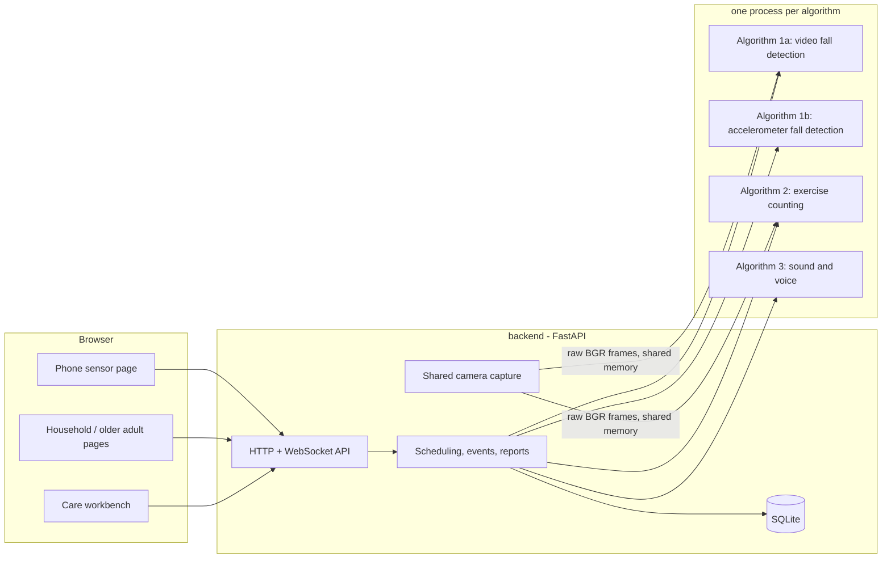

# HomeEase - Your Home Care Buddy

HomeEase is a local, privacy-first home-care system for older adults who live alone. It combines three pattern-recognition algorithms in one application:

- **Fall detection** from a home camera and from a phone accelerometer, as two independent branches;
- **Exercise recognition and rep counting** for four fall-prevention exercises, from the same camera;
- **Sound and voice understanding**: ambient sound labels, spoken calls for help, and a spoken "Are you OK?" inquiry after a suspected fall.

Everything runs on one computer. A web interface serves the caregiver, who verifies and resolves events, and the older adult, who can call for help, answer the voice inquiry and follow a daily exercise plan.

> Group project of **Group 10**, Pattern Recognition Systems: Gao Xinghe, Lin Kai, Sun Yancheng, Yu Yuchen. The original proposal is in [`docs/project-proposal.docx`](docs/project-proposal.docx).

## Contents

- [Features](#features)
- [System architecture](#system-architecture)
- [Algorithms](#algorithms)
- [Repository layout](#repository-layout)
- [Getting started](#getting-started)
- [Configuration](#configuration)
- [Data, privacy and notifications](#data-privacy-and-notifications)
- [Documentation](#documentation)
- [Limitations](#limitations)
- [Data sources and licences](#data-sources-and-licences)

## Features

| Page | Address | For | What it does |
| --- | --- | --- | --- |
| Care workbench | `/` | caregiver | care overview, fall detection (video + accelerometer), exercise, sounds and inquiries, event center, care report, movement plan, background algorithms, profile and settings |
| Household entry | `/home` | older adult | one-tap Home Monitoring (video fall detection, sound listening, voice inquiry) and Exercise with movement guides |
| Older adult page | `/elder` | older adult | help button, "I'm OK", answering the voice inquiry, withdrawing an accidental alarm |
| Sensor page | `/sensor` | phone | streams the phone's accelerometer to the server |
| Reports | `/reports/print`, `/reports/events/{id}` | caregiver | printable care and event reports, CSV export |
| API docs | `/docs` | developers | interactive OpenAPI documentation |

How an event is handled:

1. An original detector reports a suspected fall (video or accelerometer), creating a **PENDING** event; the help button or a spoken call for help creates an **EMERGENCY**.
2. The older adult's page asks "What's wrong? Are you OK? Do you need help?" and listens for 10 seconds.
3. No answer, an unclear answer or a call for help escalates the event to EMERGENCY; a trusted "I'm fine" or the "I'm OK" button only stops the escalation.
4. Caregivers are notified (in-app, browser notifications, optional webhook) and escalate through the contact list.
5. **Only a caregiver closes an event**, by recording a resolution: confirmed fall, false alarm, verified safe or undetermined.

## System architecture



- The **frontend** (`frontend/`) is plain HTML, CSS and JavaScript served by the backend; there is no build step.
- The **backend** (`backend/`) is the integration layer: HTTP / WebSocket routes, scheduling, the event workflow, storage and notifications.
- Each **algorithm** (`algorithms/`) runs in its own worker process and is called through a thin adapter (`backend/workers.py`) over JSON pipes. The original code, weights and decision rules are used as delivered; a failing algorithm cannot take down the others.
- One camera capture is shared between video fall detection and exercise counting, so both can run at the same time.
- The two fall branches decide independently. HomeEase adds event-level coordination (a 10 s window tags events as single / dual / triple channel) but no new fusion classifier.

More detail: [docs/architecture.md](docs/architecture.md).

## Algorithms

| Module | Approach | Key result | Folder |
| --- | --- | --- | --- |
| **1a. Video fall detection** | YOLOv8n person detection -> our P1 pose U-Net (trained from scratch) -> A4 hybrid ensemble (7 base learners, OOF stacking + XGBoost) on 2 s skeleton windows | real-time on a laptop GPU (~20 fps at 640x480); P1 PCK@0.2 = 43.1% | [`algorithms/fall_video`](algorithms/fall_video) |
| **1b. Accelerometer fall detection** | 60 Hz resampling, zero-phase 5 Hz Butterworth, 2 s / 0.25 s windows, 39 statistical features, RF(400) + XGB(400) probability average | sequence AUROC **0.9853 +/- 0.0010**, event accuracy 0.826 (URFD, 3 seeds x 5-fold CV); best of four compared approaches | [`algorithms/fall_signal`](algorithms/fall_signal) |
| **2. Exercise recognition and counting** | YOLO11n-pose keypoints -> stable80 features -> hierarchical causal TCN (action head + per-exercise phase heads) -> ordered-transition decoder -> complete-cycle counter | test action Macro-F1 **0.9612**, count MAE **0.10** reps, MAPE **1.25%** (UI-PRMD reconstructed replays); 11 architectures compared | [`algorithms/exercise`](algorithms/exercise) |
| **3. Sound and voice** | Silero VAD; YAMNet embedding + logistic regression for sound events; Whisper tiny + reply rules v2 for calls for help and inquiry replies; optional voiceprint gate | reply recognition Macro-F1 0.894 (rules v2); Silero speech-gate precision 0.995 | [`algorithms/audio`](algorithms/audio) |

The video, accelerometer and audio folders each have a README with the design, experiments and results. Algorithm 2 keeps the code the system serves in `homeease/` and its offline experiments in `pipeline/`, driven by `python -m algorithms.exercise <stage>`; `python -m algorithms.exercise report` regenerates its result tables and figures from the recorded experiment JSON in [`algorithms/exercise/reports`](algorithms/exercise/reports).

## Repository layout

```text
HomeEase-Care-System/
├── run.py                    # start / stop the server
├── requirements.txt
├── backend/                  # integration layer (FastAPI)
│   ├── main.py               #   HTTP and WebSocket routes, access control
│   ├── services.py           #   scheduling, background channels, sessions, reports
│   ├── events.py             #   event workflow and notifications
│   ├── inquiry.py            #   voice-inquiry conclusions
│   ├── storage.py            #   SQLite persistence
│   ├── records.py            #   deletion of records, clips and traces
│   ├── camera.py             #   shared camera capture (shared memory)
│   ├── workers.py            #   adapters to the original algorithm entry points
│   ├── exercise.py, media.py, schemas.py, config.py
│   └── adapters/             #   worker processes, ONNX Runtime acceleration
├── frontend/
│   ├── templates/            # Jinja2 pages: workbench, household, elder, sensor, reports
│   └── static/               # JavaScript, CSS, icons, exercise guide images
├── algorithms/
│   ├── fall_video/           # Algorithm 1a: video fall detection
│   ├── fall_signal/          # Algorithm 1b: accelerometer fall detection
│   ├── exercise/             # Algorithm 2: exercise recognition and counting (homeease/ + pipeline/)
│   └── audio/                # Algorithm 3: sound events, calls for help, voice inquiry
├── samples/                  # URFD fall-01 video and accelerometer samples
├── scripts/
│   └── clear_records.py      # clear fall / exercise history while the server is stopped
└── docs/                     # architecture, API, household use, exercise integration, proposal
```

## Getting started

### Requirements

- Python **3.11** (64-bit)
- Windows, macOS or Linux; a webcam for live monitoring and exercise
- Optional: an NVIDIA GPU with CUDA for real-time video inference (the system also runs on the CPU, with a lower frame rate)
- About 300 MB of disk space for the repository (model weights and samples included)

### Install

```bash
git clone https://github.com/gaoxinghe1024/PRS_home_ease_new.git
cd PRS_home_ease_new
python -m venv .venv
source .venv/bin/activate          # Windows: .venv\Scripts\activate
pip install -r requirements.txt
```

For CUDA, install the matching PyTorch build from <https://pytorch.org> before `requirements.txt`. All model weights and samples are included in the repository; nothing is downloaded at startup.

### Run

```bash
python run.py                      # http://127.0.0.1:8000 (the next free port if 8000 is taken)
python run.py --stop               # stop gracefully; models, streams and the database are released
```

Open the address printed in the terminal. The four algorithm modules load in the background; their status is shown under **Profile and settings**, where a module can also be re-initialized.

### First steps

1. In **Profile and settings**, enter the older adult's profile and emergency contacts and send a test notification.
2. With the older adult's agreement, record the audio consent (off by default). The browser's microphone permission is needed in addition.
3. Try the detectors without any hardware: under **Fall detection**, choose the bundled video sample and the bundled acceleration sample; under **Sounds and inquiries**, run the bundled audio samples; under **Exercise**, choose the bundled skeleton sample.
4. For live use, open `/home` and choose **Home Monitoring**, or start the camera from the workbench. To stream acceleration from a phone, open `/sensor` on the phone (LAN access requires a password and HTTPS, see below).
5. Handle events in the **Event center** and review statistics under **Care report** (print to PDF or export CSV).

## Configuration

| Setting | Purpose |
| --- | --- |
| `HOMEEASE_SYSTEM_DATA` | data, log and runtime folder (default `runtime/` in the project) |
| `HOMEEASE_PASSWORD` | HTTP Basic password (username `caregiver`); required when binding to a non-loopback address |
| `HOMEEASE_VIDEO_CV_THREADS` | OpenCV threads of the video worker (default 4); does not change detection parameters |
| `HOMEEASE_VIDEO_DNN` | `auto` (default) runs the original YOLO ONNX file on CUDA through ONNX Runtime when available; `opencv` forces the original OpenCV path |
| `HOMEEASE_EXERCISE_DEVICE` | `auto` (default), `cpu` or `cuda` for Algorithm 2 |
| `run.py --host / --port` | listening address and preferred port |
| Settings page | profile, contacts, audio consent, notifications, exercise targets, contact escalation interval, background algorithm switches |

Access from another device on the LAN:

```bash
export HOMEEASE_PASSWORD='choose-a-password'      # Windows PowerShell: $env:HOMEEASE_PASSWORD = '...'
python run.py --host 0.0.0.0 --port 8000
```

Put a trusted HTTPS reverse proxy with WebSocket support in front of it; browsers only allow the camera, microphone and motion sensors on HTTPS or localhost.

Only one server instance may use a data folder at a time; starting a second one prints the address of the running one. Run several instances with different data folders and ports, and stop each with the same `HOMEEASE_SYSTEM_DATA`.

## Data, privacy and notifications

- The SQLite database is `runtime/homeease.sqlite3`, logs are in `runtime/logs/`, and uploaded videos, event clips and playback copies are in `runtime/`.
- Raw audio and transcripts are **never stored**; audio buffers are zeroed in the worker after use, and audio results are discarded when consent is withdrawn.
- Video event clips and uploaded videos are kept; manage disk space and backups according to the household's privacy agreement. `python scripts/clear_records.py` (with the server stopped) clears fall and exercise history with their notifications and clips; profile, contacts and sound history are kept.
- Notifications: in-app, browser notifications and tap-to-call contact links. With a webhook configured, live events are posted with an idempotency key and up to 5 attempts; replays never trigger external alerts. There is no built-in SMS, automatic dialling or emergency-service connection.

## Documentation

| Document | Content |
| --- | --- |
| [docs/architecture.md](docs/architecture.md) | call boundaries, how the original algorithm behaviour is preserved, state and recovery |
| [docs/api.md](docs/api.md) | HTTP / WebSocket API and data formats |
| [docs/home-use.md](docs/home-use.md) | the household entry and continuous monitoring |
| [docs/exercise-integration.md](docs/exercise-integration.md) | deployment adaptations of Algorithm 2 for live cameras and how they were checked |
| [samples/SOURCES.md](samples/SOURCES.md) | sources of the bundled samples |
| Algorithm READMEs | [fall_video](algorithms/fall_video/README.md), [fall_signal](algorithms/fall_signal/README.md), [audio](algorithms/audio/README.md); Algorithm 2 stages: [pipeline/cli.py](algorithms/exercise/pipeline/cli.py) |

## Limitations

- All reported accuracy comes from public or constructed datasets (URFD, UI-PRMD, COCO, synthetic and acted audio). Real-home accuracy, false-alarm rates with older adults, long-term (7-day) stability and real notification delivery have **not** been validated.
- Exercise counting on live cameras uses deployment-only adaptations described in [docs/exercise-integration.md](docs/exercise-integration.md); they were checked on recorded skeletons and in user field tests, not with per-repetition ground truth.
- Sound labels are hints only, and a voice reply never closes or downgrades an event.
- The accelerometer branch needs a phone running `/sensor` (or another client sending samples); a computer has no accelerometer of its own.
- Nothing is monitored while the computer sleeps or the server is stopped; sound listening and the voice inquiry need the household page to stay open.
- The interface is English only. Speech recognition understands English and Mandarin calls for help and replies.

## Data sources and licences

- **URFD** (UR Fall Detection Dataset): bundled samples and accelerometer training data, <https://fenix.ur.edu.pl/~mkepski/ds/uf.html>.
- **Le2i** and **Multiple Cameras Fall (MCF)**: training data of the video A4 ensemble.
- **UI-PRMD**: exercise skeletons, <https://webpages.uidaho.edu/ui-prmd/>.
- **COCO 2017** keypoints: pose-model comparison, <https://cocodataset.org>.
- Pre-trained models: Ultralytics YOLOv8 / YOLO11 (AGPL-3.0), Google YAMNet (Apache-2.0), faster-whisper tiny (MIT), WeSpeaker ResNet34 (CC BY 4.0), Silero VAD (MIT). See [algorithms/audio/THIRD_PARTY_NOTICES.md](algorithms/audio/THIRD_PARTY_NOTICES.md) and each algorithm's data card.
- Icons: Lucide ([frontend/static/vendor/NOTICE.txt](frontend/static/vendor/NOTICE.txt)).

Follow each dataset's and model's terms for redistribution and publication.
