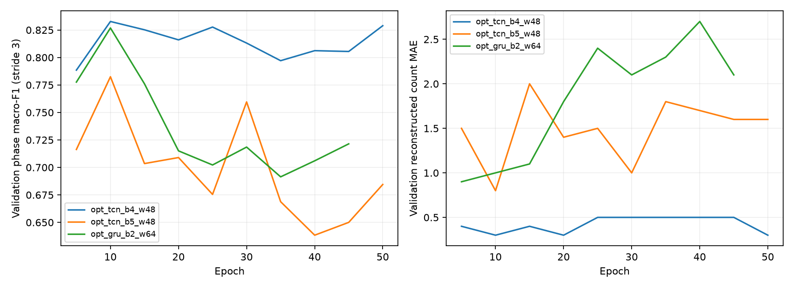

# Algorithm 2: optimization, self-check and handover record

## Current deployment conclusion

The current default algorithm is **opt_tcn_b4_w48**, checkpoint `artifacts/opt_tcn_b4_w48.pt`. Deployment still uses HTTP API v1, and the system's keypoint protocol and four-exercise enumeration stay compatible.
The network is a hierarchical TCN with 4 residual blocks (two causal convolutions each), width 48, stable80 features as input and a 64-frame causal window. The best checkpoint is from epoch 10.
Decoder `ordered_transition`, phase evidence threshold 0.25, debounce 0.033 s.
Weights SHA-256: `860da96e399fda20f4e2d06b3f198574ca91c1afd5e32101dece5977e35f53c5`.

## Before and after optimization

The phase metrics below are joint action / phase weak-label Macro-F1; MAPE only covers the eight sessions with non-zero counts, MAE includes the two negative sessions.

| Metric | Original default model | Current default model |
|---|---:|---:|
| Validation action Macro-F1 | 0.8399 | 0.9769 |
| Validation phase Macro-F1 | 0.7168 | 0.8312 |
| Validation count MAE | 1.0000 | 0.1000 |
| Test action Macro-F1 | 0.8213 | 0.9612 |
| Test phase Macro-F1 | 0.7007 | 0.8203 |
| Test count MAE | 1.8000 | 0.1000 |
| Test count MAPE % | 23.4722 | 1.2500 |
| Test complete-cycle recall | 0.7692 | 0.9872 |
| Test complete-cycle precision | 1.0000 | 1.0000 |
| Parameters | 55,185 | 62,453 |
| CPU P50 ms | 10.268 | 5.880 |
| CPU P95 ms | 15.013 | 8.009 |

A single CPU forward pass excludes feature extraction, the pose CNN, network transfer and queueing; the old model uses 64 frames, the new models their actual windows. The three optimized models were timed again during the common calibration after all training finished: 4 CPU threads, 40 warm-up runs, 300 measurements. The old / new default models were also timed in the same run as a deployment audit, see deployment_audit.json. Parameter count, window length and actual latency together explain the compute cost.

## Issues found in the self-check and the changes made

1. The first round's joint 17-class output made action classes and phases compete with each other, and the still standing posture is nearly the same for several exercises. The new network uses one five-class action head and four conditional phase heads, optimizing the action CE and the phase CE of the current action separately. The joint probability is P(action) x P(phase|action), and the interface still outputs the original 17-class probabilities.
2. The original normalization denominator depended on the projected leg length, which can change with posture when bending the knees or raising a leg. stable80 normalizes by twice the 2D torso length from the shoulder centre to the hip centre and adds left/right knee and ankle heights, the higher knee/ankle and the left-right height difference, keeping one-sided movements. It is still affected by projection and torso tilt and cannot be claimed fully view-invariant.
3. Originally the loss was computed at every position of overlapping windows, where early positions have little history. The new training supervises only the last eight frames of each window; the windows are 96, 128 and 96 frames, so most of the loss no longer comes from positions without history. All temporal operations remain causal.
4. The original training mostly used isolated clips while deployment input is a continuous stream. The new training adds cross-repetition reconstructed sequences of training participants, without passing episode, clip boundary, source count or future frames to the model.
5. Training adds sampling strides 0.85 / 1.0 / 1.15, left-right mirroring with semantic swaps, 25 / 45 / 65 degree projections and feature noise 0.025. Normalization mean and standard deviation are fitted on training participants only.
6. The TCN residual branches and input get per-frame LayerNorm, with AdamW, a cosine learning rate, weight decay, gradient clipping and mild label smoothing. The temporal model was not replaced by an MLP.

7. The theoretical receptive field of the four-block TCN is 61 frames. After training the deployment window was reduced from 96 to 64, all validation clips and sessions were inferred again, the maximum probability difference and identical per-frame phase / action argmax were checked, and then the common calibration and timing were run. The five-block TCN has a 125-frame receptive field and keeps 128; the GRU keeps 96, without applying the finite convolution receptive-field argument. Shrinking the window only changes deployment metadata; the original training checkpoints are backed up in reports/optimization/training_checkpoints.

These changes were applied to the three architectures as one joint optimization; this round has no separate ablation per change, so the total improvement cannot be attributed to any single one.

## Actual development and fixes

First the original model, features, evaluation and missed-count audit were completed and the first-round experiments and deployment configuration saved; then the hierarchical network, stable80 features and window length loaded with the checkpoint were implemented, with new causality / probability composition / feature invariance tests.
In the first optimization run, after the four-block TCN finished training and validation, building the 128-frame data for the five-block TCN failed because NumPy could not allocate a contiguous window array of about 994 MiB. Pre-expanding all overlapping windows also keeps the source array, which produces a high memory peak. It was changed to CausalWindowDataset: the source sequences are stored once and sliced per batch with start-frame padding; tests check item by item that the old and new windows and supervision labels are identical.
The finished four-block TCN weights and records were kept, and only the five-block TCN and the GRU were continued. Labels, splits and evaluation sessions were not changed or reduced because of the memory error. The final training logs, complete probability caches, selection lock and deployment self-check together verify the actual results.

## Experiment configuration and selection

| Candidate | Deployment window | Best epoch | Trained epochs | Validation action F1 | Validation phase F1 | Validation MAE | Test action F1 | Test phase F1 | Test MAE | Test MAPE | CPU P50 ms |
|---|---:|---:|---:|---:|---:|---:|---:|---:|---:|---:|---:|
| opt_tcn_b4_w48 | 64 | 10 | 50 | 0.9769 | 0.8312 | 0.10 | 0.9612 | 0.8203 | 0.10 | 1.25% | 5.880 |
| opt_tcn_b5_w48 | 128 | 10 | 50 | 0.9113 | 0.7768 | 0.50 | 0.9234 | 0.7910 | 0.50 | 6.81% | 8.808 |
| opt_gru_b2_w64 | 96 | 5 | 45 | 0.8910 | 0.7763 | 0.80 | 0.9659 | 0.8246 | 0.00 | 0.00% | 13.706 |

The three candidates are optimized versions of the TCN / GRU families that performed well in the first round; the 11 first-round configurations were not all retrained. At most 80 epochs, seed=2026, validation every five epochs, early stop after eight validations without improvement. Checkpoints are selected by validation count MAE first, then validation phase F1. During training phase F1 is computed every third frame to save cost; the final comparison of candidates uses complete per-frame metrics.

AdamW lr=0.0015, minimum lr=0.00005, weight_decay=0.005; batch=128, window stride=12; dropout=0.15, gradient clipping 1.0; loss=0.7 x action_CE + phase_CE. Action label smoothing=0.04, phase=0.025, class weights are the training frequency to the power of -0.35.

Validation count decoding of the training checkpoints compares two ordering strategies x three thresholds (0.25 / 0.35 / 0.5) x two debounce values (0.067 / 0.1 s), 12 combinations. After training, the complete validation probabilities of the three candidates were calibrated together, adding 0 / 0.033 s debounce, 24 combinations. Lowest MAE first, then cycle recall, longer debounce and higher threshold.
An additional validation diagnosis found that the action support gate of the four-block TCN gives MAE=0.3 everywhere in 0.05 / 0.1 / 0.15 / 0.2, so 0.15 was kept; reducing debounce from 0.1 to 0.033 s raises the validation s07 leg-raise count from 7/10 to 9/10 while negatives stay at zero. This led to the common post-training decoder calibration; test data was not used for this diagnosis.
Final candidate selection rule: `validation count MAE <= best+.2; joint phase F1 >= eligible best-.02; minimum CPU p50`. The selection lock file was created before the test stage and contains the deployment model, decoder, timestamp and checkpoint hash; finalize checks the hash.

## Per test session

| Session | Source count | Original default prediction | Optimized default prediction |
|---|---:|---:|---:|
| s09_m05_reconstructed | 9 | 2 | 9 |
| s10_m05_reconstructed | 9 | 9 | 9 |
| s09_m01_reconstructed | 10 | 10 | 10 |
| s10_m01_reconstructed | 10 | 10 | 10 |
| s09_m06_reconstructed | 10 | 10 | 10 |
| s10_m06_reconstructed | 10 | 0 | 9 |
| s09_m02_reconstructed | 10 | 10 | 10 |
| s10_m02_reconstructed | 10 | 9 | 10 |
| s09_m07_reconstructed | 0 | 0 | 0 |
| s10_m07_reconstructed | 0 | 0 | 0 |

## Validation scope and limits

Labels, participant split, evaluation angles, count ground truth and event matching tolerance keep the first-round definitions. Training s01-s06, validation s07-s08, test s09-s10. The original test set had been seen in the first round and in the problem diagnosis; this round keeps it for a descriptive comparison under the same protocol. The locking procedure avoids selecting the model by test score in this round, but a used test set cannot become a fresh blind test again.

The validation set has only two people, and repeated epoch and decoder comparisons risk overfitting. The results are 2D projections of public mocap, weak phase labels and reconstructed replays; natural continuous RGB video and older adults were not validated. An improvement with one seed is not statistically significant, and a correct count does not guarantee that every event time is correct. The current results do not prove a clinical fall-prevention effect.

The optimized GRU has test action F1=0.9659, phase F1=0.8246 and count MAPE=0%, slightly better numbers on this already-used test replay. But its validation count MAE=0.80 is higher than the TCN's 0.10, and its CPU latency is higher, so the TCN selected before the test stays the deployment default. Distinguishing the best test numbers from the best validation / compute trade-off avoids re-selecting by test results already seen.

## Reproduction and files

```bash
cd algorithms/exercise
python scripts/optimize_top.py --epochs 80 --seed 2026
python scripts/optimize_top.py --calibrate
python scripts/optimize_top.py --finalize
python scripts/robustness.py
python scripts/audit_optimized.py
python scripts/build_optimization_report.py
python scripts/build_report.py
```

Retraining overwrites the optimized checkpoints of the same name; reproduce in a separate copy of the project or archive them first. The original baseline records are in `reports/optimization/baseline/`, and the first-round `.pt` weights stay in artifacts.
`validation.json`: training log and complete validation metrics; `selection_lock.json`: lock made before the test; `results.json`: complete results of the three candidates; `*_probabilities.npz`: per-frame and per-session probabilities; `reports/comparison.csv`: overall table including the old and optimization rounds. The complete API contract: see [API.md](API.md).

## Additional self-check of the fixed deployment model

The two test shoulder-exercise replays were run with each of the four training targets, eight checks in total, all counting 0; the same still posture for 300 consecutive frames also counts 0 for all four targets. These checks only cover recorded negatives and do not mean that no household disturbance can cause a false count.

| Same-run CPU measurement | Window | P50 ms | P95 ms |
|---|---:|---:|---:|
| gru_b2_w64 | 64 | 8.926 | 9.964 |
| opt_tcn_b4_w48 | 64 | 5.619 | 7.490 |

With the same thread count, warm-up and number of measurements in this run, the optimized TCN is faster per inference than the old GRU, although it has about 13% more parameters.

## Stress test of the fixed model

Projection / coordinate-noise checks of the eight positive sessions; model and thresholds were not changed based on them.

| Projection angle | Noise std (original units) | Positive-session MAE | MAPE |
|---|---:|---:|---:|
| 15° | 0 | 1.375 | 15.00% |
| 45° | 0 | 0.125 | 1.25% |
| 75° | 0 | 1.500 | 15.00% |
| 45° | 1 | 2.375 | 24.58% |

The usual 45 degree projection improves clearly, but extreme angles and noise still cause clear missed counts, e.g. 0/9 for the s09 sit-to-stand at 15 degrees. The higher average accuracy does not solve the camera domain shift or every viewpoint.

## Training curves


