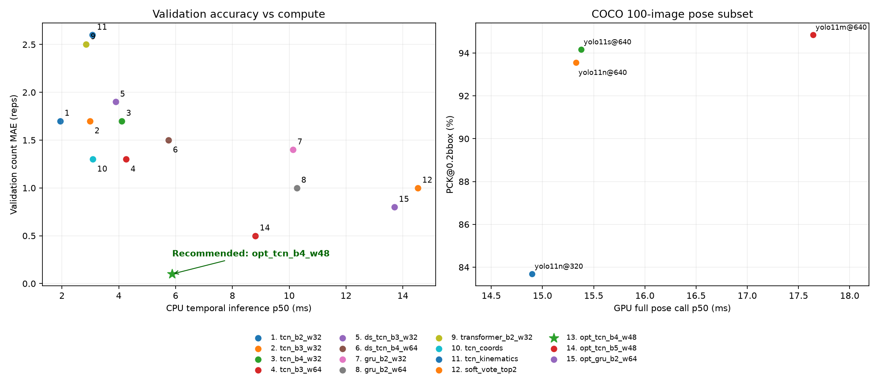
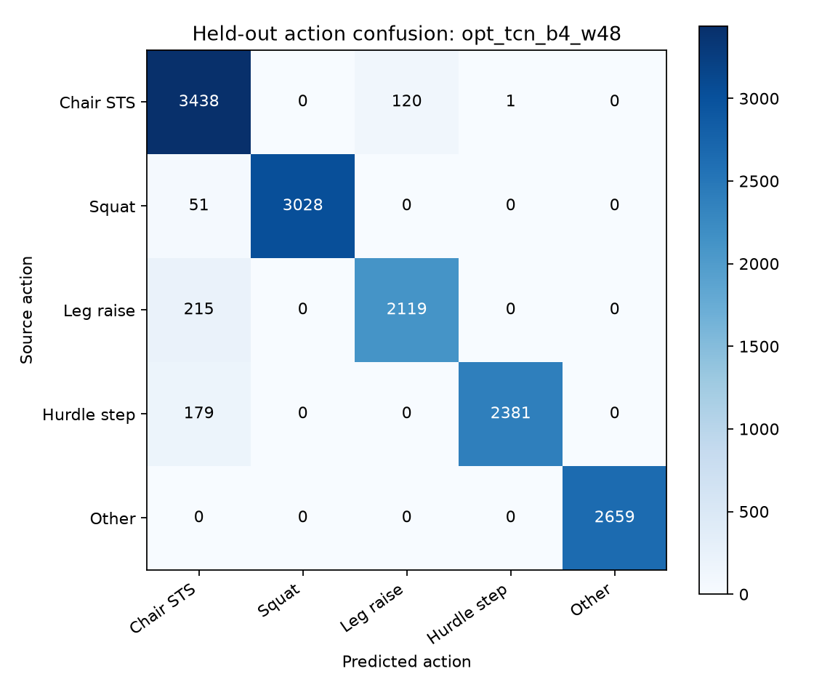
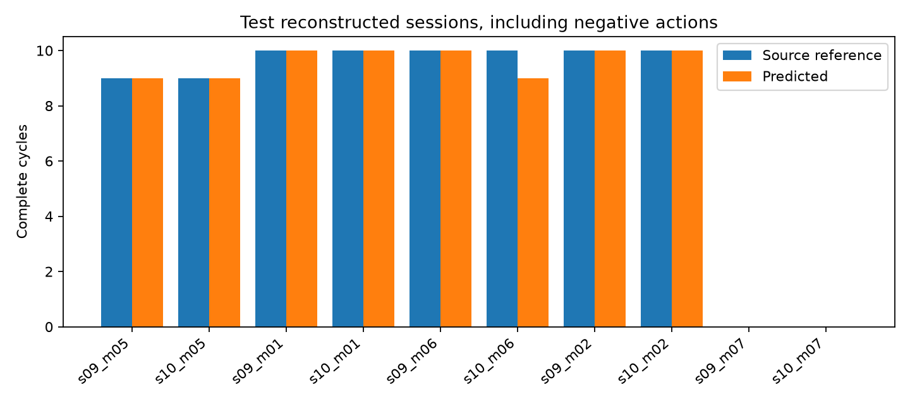

# HomeEase Algorithm 2 (four exercises): experiment results

## Best algorithm at a glance

> **Best overall and current deployment recommendation: hierarchical causal TCN `opt_tcn_b4_w48`**
> Validation count MAE **0.10 reps**; test count MAPE **1.25%**; test action Macro-F1 **0.9612**; CPU P50 **5.880 ms**.

> **Highest test replay metrics: optimized GRU `opt_gru_b2_w64`**
> Test count MAPE **0.00%**; test action Macro-F1 **0.9659**; test joint phase Macro-F1 **0.8246**.

| Key metric | **Best overall TCN (recommended for deployment)** | **Highest test metrics GRU** |
|---|---:|---:|
| Model id | **`opt_tcn_b4_w48`** | **`opt_gru_b2_w64`** |
| Validation action Macro-F1 ↑ | **0.9769** | **0.8910** |
| Validation joint phase Macro-F1 ↑ | **0.8312** | **0.7763** |
| Validation count MAE ↓ | **0.10 reps** | **0.80 reps** |
| Test action Macro-F1 ↑ | **0.9612** | **0.9659** |
| Test joint phase Macro-F1 ↑ | **0.8203** | **0.8246** |
| Test count MAE ↓ | **0.10 reps** | **0.00 reps** |
| Test count MAPE ↓ | **1.25%** | **0.00%** |
| Test relative count accuracy ↑ | **98.75%** | **100.00%** |
| Test exact-session rate ↑ | **90.0%** | **100.0%** |
| Test cycle recall ↑ | **0.9872** | **1.0000** |
| Test cycle precision ↑ | **1.0000** | **1.0000** |
| CPU temporal forward P50 ↓ | **5.880 ms** | 13.706 ms |
| CPU temporal forward P95 ↓ | **8.009 ms** | 19.330 ms |
| Parameters | 62,453 | 58,005 |

**Why the TCN is recommended:** its validation count MAE is **0.10 reps**, lower than the GRU's 0.80 reps, and the GRU's CPU P50 is **2.33 times** that of the TCN. The TCN is therefore chosen on validation performance and compute cost, and the GRU is kept as the candidate with the best test replay accuracy. Model and decoder were locked before this round's test.

The F1 scores above are Macro-F1; phase labels are kinematic weak labels. MAE covers ten sessions (eight positive, two negative); MAPE excludes the two zero-reference sessions. Relative count accuracy = 100% - MAPE, not a classification accuracy. CPU is a single temporal forward pass on this machine, without the pose CNN, HTTP, feature extraction or queueing.

## Before and after optimization: original default GRU -> best overall TCN

| Metric | Original default `gru_b2_w64` | **Optimized `opt_tcn_b4_w48`** |
|---|---:|---:|
| Test action Macro-F1 | 0.8213 | **0.9612** |
| Test joint phase Macro-F1 | 0.7007 | **0.8203** |
| Test count MAE | 1.80 reps | **0.10 reps** |
| Test count MAPE | 23.47% | **1.25%** |
| Test cycle recall | 0.7692 | **0.9872** |

Test action F1 improves by **13.99 percentage points**; count MAE drops by **94.44%**. This is a descriptive comparison under the same labels and split.

## Per-exercise results of the best overall TCN

**77/78 reference cycles matched, 1 missed, 0 spurious.** Both negative shoulder-exercise sessions counted 0.

| Exercise | Reference cycles | Predicted cycles | MAE (reps) | MAPE | Exact-session rate | Cycle recall | Cycle precision |
|---|---:|---:|---:|---:|---:|---:|---:|
| Chair sit-to-stand `chair_sit_to_stand` | 18 | **18** | 0.00 | **0.00%** | 100.0% | 1.000 | 1.000 |
| Squat `squat` | 20 | **20** | 0.00 | **0.00%** | 100.0% | 1.000 | 1.000 |
| Standing straight-leg raise `standing_leg_raise` | 20 | **19** | 0.50 | **5.00%** | 50.0% | 0.950 | 1.000 |
| Hurdle step `hurdle_step` | 20 | **20** | 0.00 | **0.00%** | 100.0% | 1.000 | 1.000 |

Only two test participants per exercise. Cycle timing is matched with a weak boundary of +/-0.5 s; the count reference comes from the original segment repetitions.

## Deployment configuration of the best algorithm

Weights actually loaded: `opt_tcn_b4_w48.pt`, see `artifacts/selected.json`. Decoder `ordered_transition`, phase evidence threshold 0.25, debounce 0.033 s, deployment window 64 frames. Default pose frontend: **yolo11n-pose.pt @ 640**. Integration: see [API.md](API.md); the full optimization process: see [OPTIMIZATION.md](OPTIMIZATION.md).

Deployment selection rule: `validation count MAE <= best+.2; joint phase F1 >= eligible best-.02; minimum CPU p50`. The original test set had been seen in the previous round; this round locked the selection on the validation set first and then reused the test set for a descriptive comparison, so it is not a fresh blind test. Results on projected public skeletons, weak labels and reconstructed replays do not equal performance on home videos of older adults.

## Full model comparison (best candidates first)

| Model and role | Parameters | CPU P50 ms | Validation MAE | Test action F1 | Test joint phase F1 | Test MAE | Test MAPE |
|---|---:|---:|---:|---:|---:|---:|---:|
| **opt_tcn_b4_w48 (best overall / recommended for deployment)** | **62,453** | **5.880** | **0.10** | **0.9612** | **0.8203** | **0.10** | **1.25%** |
| **opt_gru_b2_w64 (highest test metrics)** | **58,005** | **13.706** | **0.80** | **0.9659** | **0.8246** | **0.00** | **0.00%** |
| tcn_b2_w32 | 15,057 | 1.935 | 1.70 | 0.8307 | 0.7010 | 2.20 | 28.47% |
| tcn_b3_w32 | 21,265 | 2.992 | 1.70 | 0.8315 | 0.7081 | 1.10 | 13.75% |
| tcn_b4_w32 | 27,473 | 4.104 | 1.70 | 0.8823 | 0.7463 | 2.10 | 27.36% |
| tcn_b3_w64 | 79,377 | 4.258 | 1.30 | 0.8421 | 0.7208 | 1.90 | 24.86% |
| ds_tcn_b3_w32 | 9,745 | 3.890 | 1.90 | 0.8420 | 0.7162 | 1.30 | 16.25% |
| ds_tcn_b4_w64 | 40,593 | 5.748 | 1.50 | 0.8407 | 0.7056 | 2.10 | 26.53% |
| gru_b2_w32 | 15,313 | 10.131 | 1.40 | 0.8175 | 0.6760 | 1.90 | 25.00% |
| gru_b2_w64 | 55,185 | 10.268 | 1.00 | 0.8213 | 0.7007 | 1.80 | 23.47% |
| transformer_b2_w32 | 19,729 | 2.851 | 2.50 | 0.8645 | 0.7142 | 3.00 | 37.78% |
| tcn_coords | 19,985 | 3.082 | 1.30 | 0.8208 | 0.6803 | 2.00 | 25.14% |
| tcn_kinematics | 19,729 | 3.076 | 2.60 | 0.7042 | 0.6302 | 1.70 | 22.08% |
| soft_vote_top2 | 134,562 | 14.526 | 1.00 | 0.8397 | 0.7250 | 1.40 | 18.06% |
| opt_tcn_b5_w48 | 76,469 | 8.808 | 0.50 | 0.9234 | 0.7910 | 0.50 | 6.81% |

Ensemble latency is the sum of the members measured separately; in particular the summed P95 is not a measured joint P95. First round seed=42, optimization round seed=2026; no repetition over several seeds. CPU timings are from this machine, and timing conditions may differ between rounds.

## Per test session

| Reconstructed session | Source reference | Predicted |
|---|---:|---:|
| s09_m05_reconstructed | 9 | 9 |
| s10_m05_reconstructed | 9 | 9 |
| s09_m01_reconstructed | 10 | 10 |
| s10_m01_reconstructed | 10 | 10 |
| s09_m06_reconstructed | 10 | 10 |
| s10_m06_reconstructed | 10 | 9 |
| s09_m02_reconstructed | 10 | 10 |
| s10_m02_reconstructed | 10 | 10 |
| s09_m07_reconstructed | 0 | 0 |
| s10_m07_reconstructed | 0 | 0 |

## Pose CNN comparison

100 official COCO val images, 198 annotated people, 2,482 visible keypoints. This is not a full COCO AP; the PCK threshold is 20% of the longest bbox side and missed detections count as errors.

| Pose CNN | Input | PCK@0.2 | Mean OKS | Matched people | GPU P50 ms | GPU P95 ms | Parameters |
|---|---:|---:|---:|---:|---:|---:|---:|
| yolo11n-pose.pt | 320 | 83.68% | 0.6624 | 171/198 | 14.90 | 98.54 | 2,874,462 |
| yolo11n-pose.pt | 640 | 93.55% | 0.7811 | 190/198 | 15.33 | 98.22 | 2,874,462 |
| yolo11s-pose.pt | 640 | 94.16% | 0.8190 | 190/198 | 15.38 | 74.32 | 9,918,238 |
| yolo11m-pose.pt | 640 | 94.84% | 0.8460 | 190/198 | 17.64 | 60.70 | 20,912,364 |

Timing includes preprocessing, forward pass and post-processing, with CUDA synchronization. A P50 within the 30 FPS budget does not mean the P95 is, and not all system overhead is included.

## Figures

## Does it meet the proposal target?

The overall reconstructed-replay MAPE of the current default model is 1.25%. It reaches <=5% on this limited replay, but acceptance on home videos cannot be declared yet.

Code, trained weights, four-exercise recognition and counting, the interface and the offline experiments are implemented. The next step is independently hand-labelled natural continuous camera video, including older adults, different viewpoints, occlusion and everyday disturbances, to validate keypoint error and full-cycle performance with the real frontend.

## Viewpoint and noise tests of the fixed model

The table only covers the eight positive sessions of the four exercises, so the MAE denominator differs from the main table, which includes two negative sessions; model and thresholds were not changed based on these tests. Noise is in the original UI-PRMD length unit, not pixels of a particular camera.

| Projection angle | Coordinate noise std | Positive-session MAE | MAPE |
|---|---:|---:|---:|
| 15° | 0 | 1.375 | 15.00% |
| 45° | 0 | 0.125 | 1.25% |
| 75° | 0 | 1.500 | 15.00% |
| 45° | 1 | 2.375 | 24.58% |

The 15 / 75 degree views of unseen training participants are a projection robustness stress test and do not replace acceptance at real camera angles.

This file is generated by `scripts/build_report.py` from the actual experiment JSON. Development method and evaluation limits: see [DEVELOPMENT.md](DEVELOPMENT.md).
