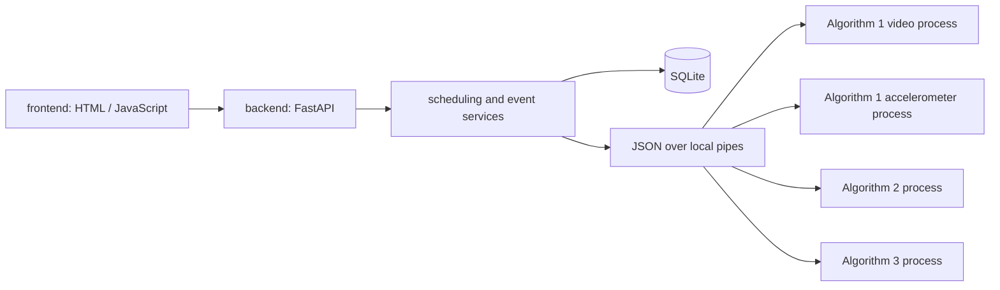

# Architecture and Algorithm Integration

## Call boundaries

| Layer | Location | Responsibility |
| --- | --- | --- |
| Frontend | `frontend/templates`, `frontend/static` | caregiver workbench, household entry, older adult page, sensor page, printable reports |
| HTTP / WebSocket | `backend/main.py` | routes, input limits, access control |
| Scheduling | `backend/services.py` | module lifecycle, background channels, sessions, reports |
| Events | `backend/events.py`, `backend/inquiry.py` | event handling, notifications, voice-inquiry conclusions |
| Storage | `backend/storage.py`, `backend/records.py` | transactions, persistence, record deletion |
| Camera | `backend/camera.py` | one capture per device, shared memory for raw BGR frames |
| Process isolation | `backend/adapters/process.py` | worker processes, timeouts, recovery |
| Algorithm adapters | `backend/workers.py` | thin adapters to the original algorithm entry points |
| Algorithms | `algorithms/*` | the delivered algorithm code, weights and samples |

Each module can be initialized, called and shut down independently through `AlgorithmProcess("video" | "signal" | "exercise" | "audio")`. Algorithms 2 and 3 both contain a package named `homeease`; separate processes avoid import clashes and also isolate a failing algorithm from the reports and the other algorithms.

## Keeping the original behaviour

**Video (Algorithm 1a).** The delivered engine expects `systems/` next to `standalone/`, so the worker builds that layout in the runtime folder and copies the source files byte for byte. It uses the engine's `DetectionEngine` with its default threshold, consecutive confirmation, window, cool-down, sampling and clip saving. H.264 transcoding only creates a browser playback copy; the original evidence clip is never overwritten.

**Accelerometer (Algorithm 1b).** The worker uses the original `BestFallModel`, `detect_offline` and `StreamingDetector`. The delivered CSV reader's four-column padding does not match the indices it actually reads, so a four-column CSV with explicit units is converted to the native five-column format in the adapter before the original reader runs. Features, resampling, model probabilities and event rules are all executed by the original code.

**Exercise (Algorithm 2).** The worker calls the original FastAPI app contract inside its process, including batch idempotency, parameter validation, session state, counting and interruption handling. Camera and uploaded video go through the original `PoseEstimator` and then the original `/v1/sessions/{id}/frames`; the cycle logic is not rewritten. `backend/camera.py` opens each camera index once and passes raw BGR pixels through shared memory with a sequence-number consistency check. For video only the camera entry of `FrameSource` is adapted; files and replays use the original entry. Exercise sessions use the capture's monotonic clock with a single inference in flight, and pause / end share the session lock with frame submission. The camera closes when its last algorithm user leaves; browser previews never own the device. Deployment-only counting extensions are documented in [exercise-integration.md](exercise-integration.md).

**Audio (Algorithm 3).** The worker initializes the original Silero VAD strictly and never silently falls back to the energy VAD. Offline joint analysis passes one decoding to the original `label_sounds` and `detect_spoken_help`; continuous PCM uses the original `Function3Pipeline`, `SoundMonitor` and `HelpListener`, running all sound classes and help listening at once. Inquiry conclusions and channel tags call the original policy functions. Sound classes never become a fall decision on their own; video and accelerometer run in parallel and decide independently, and they are never merged into a new fall model.

**Video stream.** The preview is delivered as continuous MJPEG, separate from the 2.5 s status polling. The video process uses 4 OpenCV threads by default and keeps the original detection step, A4 decision step, 15 FPS sampling target and all model parameters. The page shows the engine's measured inference FPS rather than inflating it by repeating cached frames.

## State and recovery

- A suspected fall from an original detector creates a PENDING event; a help request creates an EMERGENCY event. A spoken call for help escalates according to the original policy; "I'm safe" is only recorded for verification. Only a caregiver's explicit resolution closes an event.
- The inquiry records whether the question was played and the listening, recognizing, unavailable and completed states. A question that was not played and audio failures are never treated as safe. Answers are recorded for 10 s with a short network margin, and recognition has its own bounded wait.
- Event writes carry a deduplication key and a revision number: repeated input does not create the same event twice, and outdated updates return a conflict. Replays and live data are kept apart in the database, notifications and reports.
- Module errors and call durations are logged. A timeout recycles that module's process, and it can be re-initialized from Settings. On Windows both the venv launcher and its real worker process are tracked; only the system's own child processes are terminated, never other programs by name.
- Live input timeouts, no person detected, a disconnected sensor and a degraded audio pipeline are each recorded as coverage states. Browser exercise data missing for more than 10 s pauses the session. After a restart, unfinished sessions are marked interrupted and offline periods are reconstructed from heartbeats.
- Shared-camera exercise sessions are kept alive by the page's polling. When the browser leaves, the session is ended; a heartbeat missing for more than 15 s ends it and releases that user without stopping independent video fall detection.
- The explicit stop acknowledgement of a WebSocket is sent after the original pipeline has shut down and its lock is released. Closing camera, audio and sensor streams releases the browser devices, and the sensor queue is drained before disconnecting.
- SQLite runs with WAL, foreign keys and transactions. Audio consent is off by default, and recordings and transcripts are never stored. Audio results are discarded once consent is withdrawn.

## Mapping to the proposal

Implemented: the caregiver workbench and the simplified older adult page, current coverage, event evidence, notifications and contacts, responses and manual resolution, exercise records, 7 / 30 / 90-day statistics and exports. The system produces no posture score, balance score, clinical risk score or recognition accuracy without a basis in the original algorithms. The proposal's performance and long-running targets are metrics still to be evaluated, and the interface does not present them as achieved.
